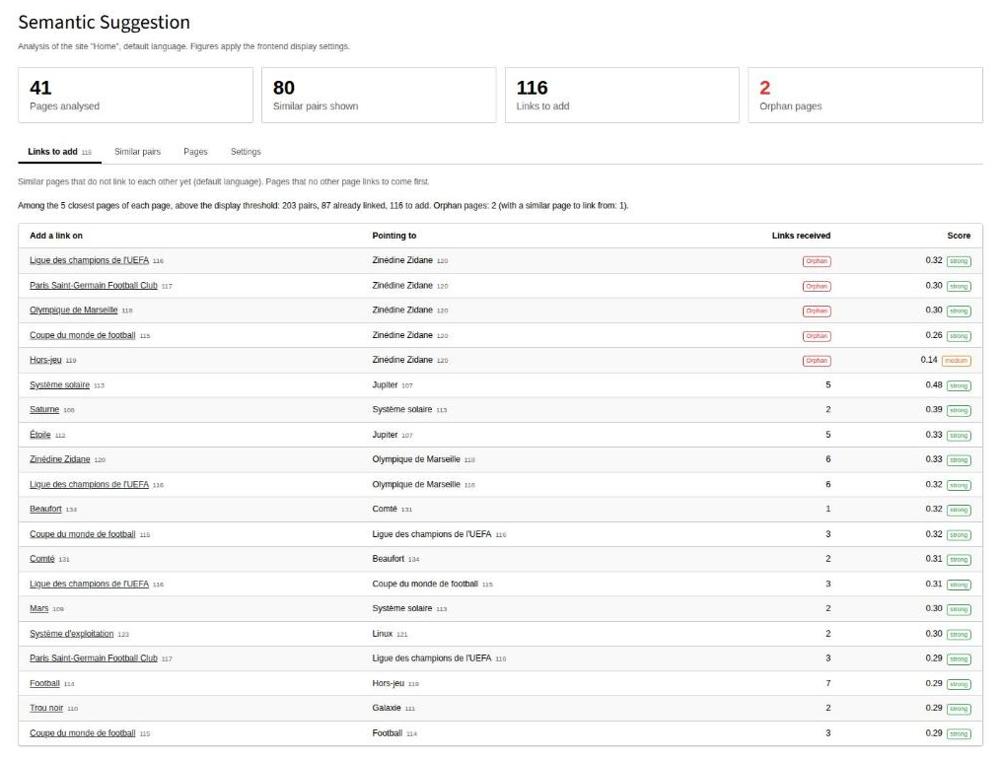

..  include:: /Includes.rst.txt

..  _backend-module:

==============
Backend module
==============

:guilabel:`Web > Semantic Suggestion` shows what the scheduler task stored. It never
computes anything itself, so opening it is safe on a production site.

    Key figures, then the *Links to add* tab.

The page tree is hidden on purpose: the module works on one *analysis* at a time. With
several analyses (one per site), a selector lists them above the figures.

..  _backend-module-sections:

What it shows
=============

Four key figures sit at the top: pages analysed, similar pairs shown to visitors, links
to add, and orphan pages (pages no other page links to). Everything below applies the
frontend display settings (quality level, ``excludePages``, ``maxSuggestions``), so the
module shows what visitors actually get. Default language only.

..  list-table::
    :header-rows: 1

    *   -   Tab
        -   Content
    *   -   Links to add
        -   Similar pages that do not link to each other yet, orphan pages first — see
            :ref:`backend-module-link-opportunities`. Each source page opens in the
            *Page* module.
    *   -   Similar pairs
        -   The 50 most similar pairs among the suggestions visitors see, with a
            relevance label: *strong* from 0.25, *medium* from 0.1, *weak* below.
    *   -   Pages
        -   Every analysed page with the suggestions it shows and the links it receives.
            Pages without any suggestion, then orphan pages, come first.
    *   -   Settings
        -   The display settings in effect, the analysed pages per language, and a short
            explanation of the two thresholds.

Tabs can be switched off in TypoScript (:typoscript:`showLinkOpportunities`,
:typoscript:`showTopSimilarPairs`, :typoscript:`showTopSimilarPages`), as can the
language figures (:typoscript:`showLanguageStatistics`) — see
:ref:`configuration-typoscript`.

..  _backend-module-link-opportunities:

Link opportunities
==================

The analysis says which pages are close; the reference index (:sql:`sys_refindex`)
says which pages already link to which. The panel lists the pairs where the first page
does not link to the second yet: each row is a link an editor can add.

*   **Which pairs.** For each page, its 5 closest pages at or above the display quality
    level. Further neighbours are left out: above the threshold a page can still be
    loosely related to dozens of others, and those are not links worth adding.
*   **Which links count as existing.** Links to a page from a visible content element of
    the default language, as recorded in the reference index. Links in other tables
    (news, records) and in translations are not counted.
*   **Order.** Pages that no other page links to (*orphans*) come first, then the most
    similar pairs. A link to an orphan page is worth more than one more link between
    pages that are already well connected.
*   **Action.** The source page links to the *Page* module, where the link is added.

The summary line counts the pairs considered, those already linked, those to add, the
orphan pages, and how many of them have a similar page that could link to them. An
orphan page with no similar page above the threshold needs a link that this analysis
cannot suggest.

..  note::
    The panel reads the reference index. If links were added outside the backend (by
    an import, for instance), update it first:
    :shell:`vendor/bin/typo3 referenceindex:update`.

Default language only: similarity rows store default-language page uids, and
translated content usually mirrors the default links.

..  _backend-module-access:

Access control
==============

*   **Administrators** see every analysis of the instance.
*   **Other backend users** see only the analyses of sites they hold a **webmount**
    on. A webmount on a subpage resolves to that page's site, so an editor mounted on
    one section still sees their whole site's analysis — and nothing from other sites.
*   The ``rootPageId`` URL argument is validated against that same list, so it cannot
    be used to reach another site's data.

A user with no webmount inside any configured site sees an empty module.

..  note::
    Module access itself is granted the usual way, per backend user group
    (:guilabel:`Access Lists > Modules > Web > Semantic Suggestion`).
